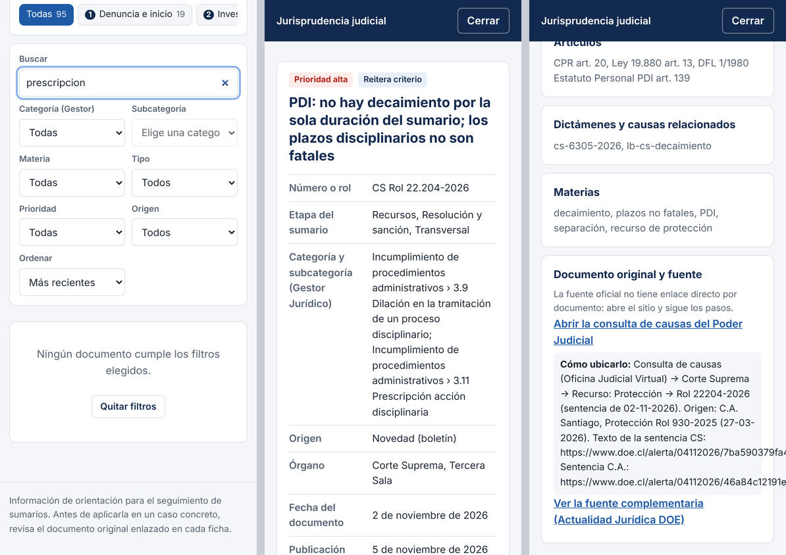
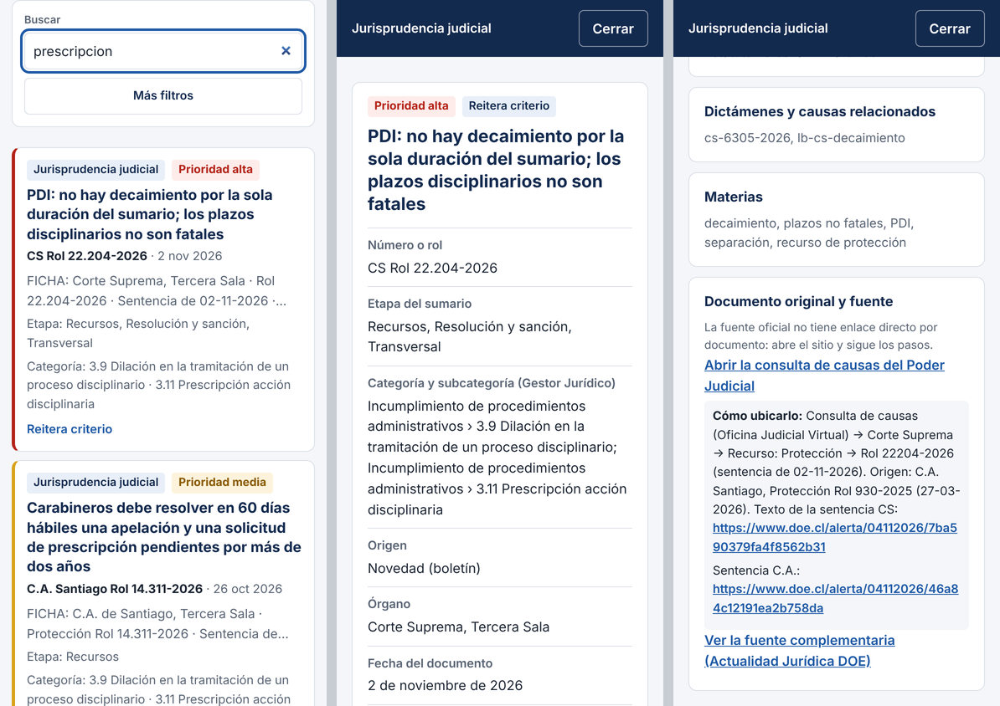
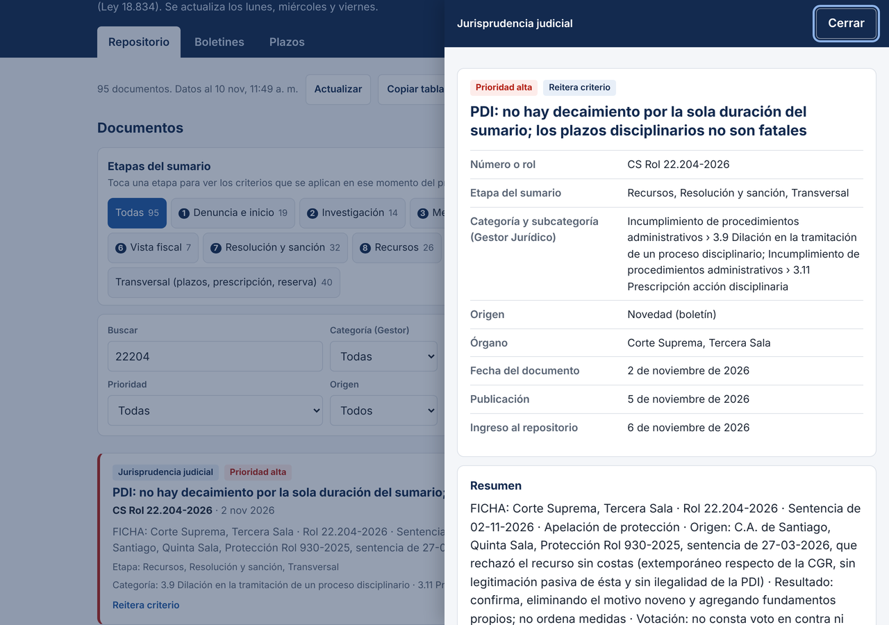

# Propuesta de diseño – 10-11-2026

Propuesta semanal pendiente de aprobación. No modifica el sitio publicado (`index.html` de la raíz). Para verla en el teléfono: https://jvergara2018-design.github.io/repositorio-cgr/propuesta/

**Incluye también la propuesta del 03-11-2026**, que no se alcanzó a publicar: filtros plegables en el teléfono («Más filtros»), campos de 16 px y botones de 44 px, mensaje «No se pudieron cargar los documentos» con «Reintentar» y etiquetas más legibles. Si apruebas, se publican ambas semanas juntas.

## Cambios nuevos de esta semana

1. **Tocar un resultado después de buscar ya abre la ficha al primer intento.** Hoy, si escribes en el buscador y luego tocas un documento de la lista, no pasa nada: hay que tocarlo dos veces. Ocurre porque la lista se volvía a dibujar justo al salir del buscador y el toque se perdía. Ahora la lista se actualiza solo mientras escribes, y el primer toque funciona (probado en teléfono y computador).
2. **El buscador encuentra con o sin tildes, y los números con o sin puntos.** Hoy, buscar «prescripcion» (sin tilde, como se escribe rápido en el teléfono) da **0 resultados**, mientras «prescripción» da 13. Lo mismo con «22204» frente a «22.204». Ahora ambas formas dan el mismo resultado: «prescripcion» → 13, «22204» → CS Rol 22.204-2026, «sernac indemnizacion» → CS Rol 2.987-2026. Las mayúsculas tampoco importan.
3. **La ficha se lee mejor en el teléfono.** En pantallas angostas, los datos de la ficha (número, etapa, categoría, órgano, fechas) se muestran con la etiqueta arriba y el valor abajo, a todo el ancho y en letra de 16 px, en vez de dos columnas estrechas donde la categoría ocupaba hasta 10 líneas. En el computador se ve igual que antes.
4. **«Cómo ubicarlo» sin desbordes y con enlaces tocables.** Las direcciones web largas de «Cómo ubicarlo» se salían del recuadro y hacían que la ficha se moviera hacia el lado (69 px de desplazamiento lateral en un iPhone). Ahora se cortan dentro del recuadro y además se pueden tocar para abrir el texto de la sentencia, en vez de tener que copiarlas.
5. **Mejor uso con teclado y lector de pantalla.** El recuadro que marca dónde está el foco ahora es azul oscuro sobre fondo claro (antes era celeste pálido y casi no se veía sobre blanco); en el encabezado se mantiene claro. Con la ficha abierta, la tecla Tab recorre solo la ficha (antes se escapaba a la página de atrás), y las pestañas Repositorio/Boletines/Plazos se pueden cambiar con las flechas ← →.

No se tocaron colores base, tipografía, estructura, los dos modos de datos (REST público y conector de claude.ai), Mi seguimiento ni la pestaña Abogado (beta). Se probó con los 95 documentos y 5 boletines actuales, en 390×844 y 1280×900, modo claro y oscuro (el sitio no tiene modo oscuro propio y se ve igual), listado, ficha, boletines, plazos, búsqueda, teclado, estado de error y modo claude.ai simulado, sin errores de JavaScript. El código no usa sintaxis nueva (compatible con Safari antiguo).

## Capturas

Antes (teléfono: búsqueda sin tilde sin resultados, ficha en dos columnas, enlaces que se salen): 

Después (teléfono): 

Después (escritorio, búsqueda «22204» y ficha abierta): 

## Observación para más adelante
Sigue sin modo oscuro (se lee bien en modo claro). En el teléfono, el encabezado con la descripción y la barra «Actualizar / Copiar tabla» ocupan casi un tercio de la pantalla antes del buscador; podría compactarse en una próxima revisión.
