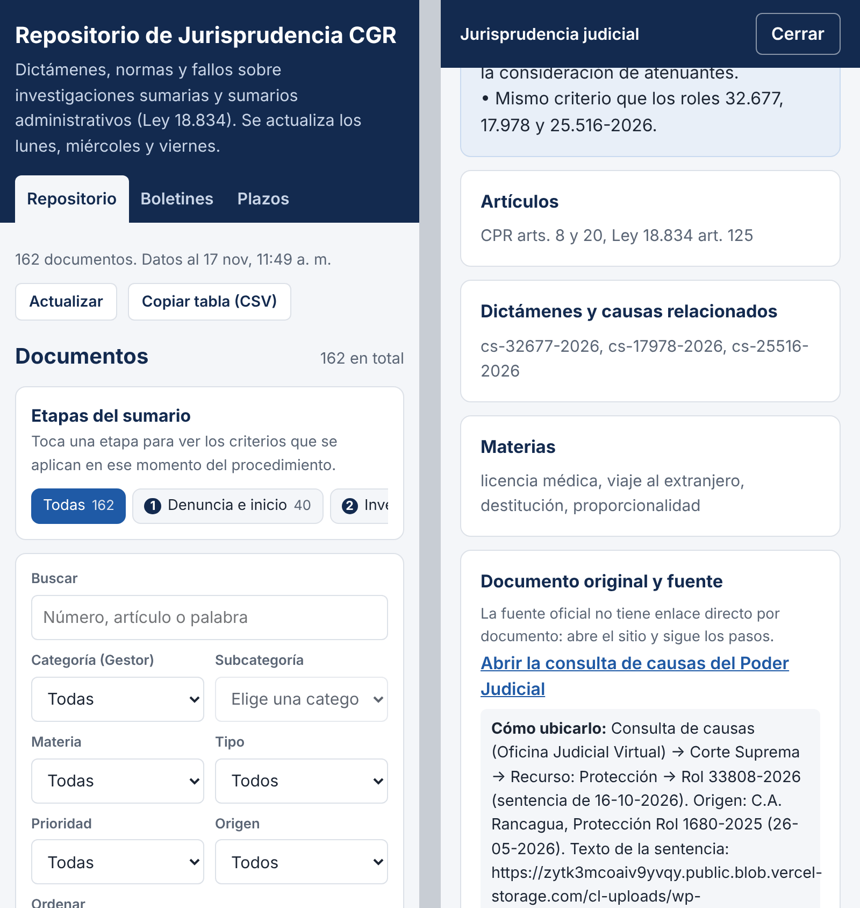
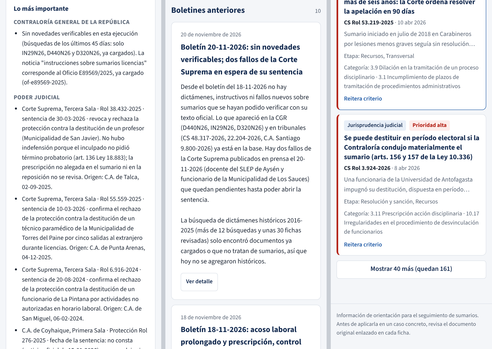
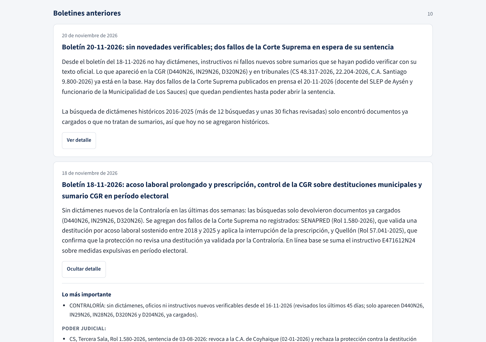

# Propuesta de diseño – 17-11-2026

Propuesta semanal pendiente de aprobación. No modifica el sitio publicado (`index.html` de la raíz). Para verla en el teléfono: https://jvergara2018-design.github.io/repositorio-cgr/propuesta/

**Incluye también las propuestas del 03-11 y del 10-11-2026**, que aún no se publican (filtros plegables, toques de 44 px, mensaje de error con «Reintentar», búsqueda sin tildes, ficha en una columna en el teléfono, enlaces en «Cómo ubicarlo», foco y teclado). Si apruebas, se publican las tres semanas juntas.

## Cambios nuevos de esta semana

1. **La lista muestra de qué trata cada fallo, no su encabezado técnico.** En 85 de los 162 documentos (casi todos los fallos), las dos líneas de vista previa de cada tarjeta mostraban el encabezado «FICHA: Corte…, Sala… · Rol… · Sentencia de…», que repite lo que ya dice la tarjeta. Ahora la vista previa salta ese encabezado y muestra el primer párrafo de fondo (por ejemplo: «Dos exfuncionarios fueron dados de baja por conducta mala en 2019…»). El resumen completo, con el encabezado, sigue intacto en la ficha, y la búsqueda sigue buscando en todo el texto.
2. **Los documentos relacionados se pueden tocar para abrir su ficha.** Hoy, en «Dictámenes y causas relacionados», algunos aparecían con códigos internos poco legibles (por ejemplo «cs-32677-2026») y ninguno se podía abrir. Ahora, cuando el documento relacionado está en el repositorio, aparece como botón con su número real («CS Rol 32.677-2026») y al tocarlo se abre su ficha. Se reconocen 95 referencias; las que aún no están cargadas siguen como texto («Otros, aún no cargados en el repositorio: …»).
3. **Botón «← Volver» entre fichas.** Si pasas de una ficha a otra relacionada, arriba aparece «← Volver» para regresar a la anterior, sin perder el hilo. «Cerrar» vuelve a la lista, al mismo documento desde el que empezaste.
4. **En el teléfono, el buscador aparece mucho antes.** Se oculta en pantallas angostas el texto descriptivo del encabezado (sigue visible en el computador), se reducen algunos márgenes y el buscador queda sobre «Etapas del sumario». Resultado en un iPhone: el buscador sube de 574 px a 280 px desde el borde superior y el primer documento aparece en la primera pantalla (antes quedaba casi fuera). En el computador el orden es el mismo de siempre.
5. **«Copiar tabla (CSV)» solo aparece en Repositorio**, donde tiene sentido; en Boletines, Plazos y Abogado queda solo «Actualizar».

No se tocaron colores base, tipografía, la estructura general, los dos modos de datos (REST público y conector de claude.ai), Mi seguimiento ni la pestaña Abogado (beta). Se probó con datos reales (respaldo del 15-11: 162 documentos y 7 boletines) en 390×844 y 1280×900, modo claro y oscuro (el sitio no tiene modo oscuro propio y se ve igual), listado, ficha, navegación entre fichas relacionadas, boletines, plazos, estado de error y modo claude.ai simulado (seguimiento guardado, consulta al abogado), sin errores de JavaScript. El código no usa sintaxis nueva (compatible con Safari antiguo).

## Capturas

Antes (teléfono: encabezado largo, buscador abajo; relacionados como códigos sin enlace): 

Después (teléfono: buscador arriba, vista previa con el fondo del fallo; relacionados tocables): 

Después (escritorio, ficha con relacionados tocables): 

## Cambios de semanas anteriores incluidos

### Semana del 10-11-2026 (incluida)

1. **Tocar un resultado después de buscar ya abre la ficha al primer intento.** Hoy, si escribes en el buscador y luego tocas un documento de la lista, no pasa nada: hay que tocarlo dos veces. Ocurre porque la lista se volvía a dibujar justo al salir del buscador y el toque se perdía. Ahora la lista se actualiza solo mientras escribes, y el primer toque funciona (probado en teléfono y computador).
2. **El buscador encuentra con o sin tildes, y los números con o sin puntos.** Hoy, buscar «prescripcion» (sin tilde, como se escribe rápido en el teléfono) da **0 resultados**, mientras «prescripción» da 13. Lo mismo con «22204» frente a «22.204». Ahora ambas formas dan el mismo resultado: «prescripcion» → 13, «22204» → CS Rol 22.204-2026, «sernac indemnizacion» → CS Rol 2.987-2026. Las mayúsculas tampoco importan.
3. **La ficha se lee mejor en el teléfono.** En pantallas angostas, los datos de la ficha (número, etapa, categoría, órgano, fechas) se muestran con la etiqueta arriba y el valor abajo, a todo el ancho y en letra de 16 px, en vez de dos columnas estrechas donde la categoría ocupaba hasta 10 líneas. En el computador se ve igual que antes.
4. **«Cómo ubicarlo» sin desbordes y con enlaces tocables.** Las direcciones web largas de «Cómo ubicarlo» se salían del recuadro y hacían que la ficha se moviera hacia el lado (69 px de desplazamiento lateral en un iPhone). Ahora se cortan dentro del recuadro y además se pueden tocar para abrir el texto de la sentencia, en vez de tener que copiarlas.
5. **Mejor uso con teclado y lector de pantalla.** El recuadro que marca dónde está el foco ahora es azul oscuro sobre fondo claro (antes era celeste pálido y casi no se veía sobre blanco); en el encabezado se mantiene claro. Con la ficha abierta, la tecla Tab recorre solo la ficha (antes se escapaba a la página de atrás), y las pestañas Repositorio/Boletines/Plazos se pueden cambiar con las flechas ← →.

## Observación para más adelante
Sigue sin modo oscuro (se lee bien en modo claro). La fila «162 documentos · Actualizar» podría compactarse aún más en el teléfono. Conviene que la carga de datos registre en `dictamenes_relacionados` los identificadores de los documentos del repositorio (como ya hace en algunos), para que más referencias se vuelvan tocables.
